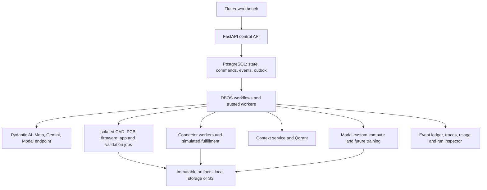

# Kleos9

Kleos9 is an agentic hardware and software workbench. A user describes a device,
refines an interactive concept, reviews feasibility, and confirms shared
engineering interfaces before workers generate CAD, electronics, firmware and a
companion application. Independent checks and revision-linked evidence control
what can become an accepted release.

The repository contains the existing Flutter experience, a real engineering
backend, a separate simulation backend, isolated native builders, and AWS
infrastructure. **Physical fabrication, human acceptance, purchases, printing,
packing and shipping remain explicitly simulated.** Digital outputs and supported
checks are real; an attractive concept preview is not manufacturing approval.

## Documentation map

| Document | Use it for |
|---|---|
| [AGENTS.md](AGENTS.md) | Shared instructions for coding agents and contributors |
| [CLAUDE.md](CLAUDE.md) | Claude Code entry point to the same repository guidance |
| [Product approval plan](agentic-diy-platform-approval-plan.md) | Intended journey, business modules and engineering gates |
| [Backend README](backend/README.md) | APIs, providers, workflows, permissions and operations |
| [Flutter README](kleos-ui/README.md) | Frontend modes, routing, authentication, transport and UI verification |
| [Mock backend README](mock-backend/README.md) | Scripted journey, seeded data and zero-provider-cost development |
| [Native image guide](backend/docker/README.md) | Native toolchains, image builds and qualification |
| [Engineering tool plugins](docs/engineering-tool-plugins.md) | Adding qualified alternative CAD/PCB tools |
| [Integration contracts](docs/backend-integrations.md) | Research, catalogs, printers, connectors and Modal compute/training |
| [Infrastructure README](infra/README.md) | AWS provisioning, deployment and recovery |
| [Native engineering review](backend/docs/reviews/2026-10-31-native-engineering.md) | Latest scoped local verification and known limits |

Use implementation and verification records to distinguish current behavior from
the broader approval plan. Test reports describe particular versions and fixtures;
they do not certify arbitrary devices, providers or deployments.

## What is implemented

| Area | Current behavior |
|---|---|
| Capture and research | Conversational requirements, saved answers, automatic planning continuation, provisional 3D anatomy/concept scenes and feasibility refinement |
| Coordination | Shared requirements/interfaces, accepted appearance references, dependencies, bounded attempts, repairs, blockers and revision invalidation |
| Models | Direct Meta and Gemini APIs; configured Modal Shared Endpoints; versioned per-lane choices in Providers, usage and estimated cost records |
| Mechanics | build123d sources, real STEP/STL, geometry-derived parts/manifests, rendered CAD views and display-only exploded views |
| Electronics | Deterministic `interfaces.circuit` → KiCad schematic/placed board → pinned Freerouting → ERC/DRC → manufacturing exports and independent correspondence checks |
| Firmware | Qualified Zephyr templates/toolchains and supported protocol/simulation checks; unsupported peripherals remain visible |
| Companion apps | Separate Flutter template, BLE permissions/connection/notifications, real web build, ARM64 development-signed APK and portable source package |
| Validation/releases | Independent checks, exact artifact closures, source hashes, evidence applicability and downloadable release packages |
| Integrations | Versioned connector contracts, configured research/catalog adapters, printer status/bridge contracts and explicitly simulated fulfillment |
| Operations | Durable command/event ledgers, DBOS recovery, traces, redacted AI/tool records, native metrics and run inspection |
| Learning | Modal compute contracts and consent/provenance/promotion foundations; growth does not automatically start training |

The initial offline PCB catalog qualifies passives, LEDs and pin headers. New
symbols/footprints, active components, boards, layouts and peripheral scenarios
need their own qualification. Unsupported work stays blocked or `UNKNOWN`.
Independent [ngspice simulation](backend/docs/circuit-simulation.md) supports an
explicitly bound ideal R/C/illustrative-LED subset with advisory digital checks
and a Flutter power-on waveform viewer. It does not qualify arbitrary components
or physical operation; [verification](backend/verification/ngspice-m7.md) separates
real direct solver runs from unrun pinned-image qualification.
Physical BLE has not been qualified by the local build checks. iOS companion
delivery is unsigned source; compiled/signed iOS delivery needs a macOS worker
and signing setup.

## Architecture



FastAPI accepts commands quickly and returns durable identifiers. A transaction
writes state and the outbox together; workers perform expensive or external work
later. PostgreSQL is authoritative, Qdrant is rebuildable retrieval, and large
immutable files live in local artifact storage or private versioned S3.

The nine logical business modules share a codebase. API, engineering, connector
and native execution processes can scale independently. DBOS owns durability;
Pydantic AI owns model interactions. The implementation does not require LangGraph.
Local trusted workers use Docker; AWS native execution uses isolated ECS/Fargate
tasks. Modal provides a separate compute adapter and an optional hosted LLM path.

### Authority and execution

Every engineering attempt pins its project revision, provider/model policy,
source references/hashes, tool installation, resource profile and fencing token.
Generated outputs are candidates. The independent validator and release services
own acceptance; synthetic physical evidence cannot unlock a live physical gate.

Supported native sessions expose fixed read, patch, build, analyze and render
actions. The model loop remains in the trusted worker; native jobs receive no
provider keys, database credentials, Docker socket or AWS task role. Sessions
persist limits, action identities and observations across recovery. Custom tool
images keep their classic build flow until their session protocol is qualified.

Partial repairs preserve unchanged source hashes/provenance. **Rebuild saved
sources** runs native compute without a new model/retrieval call. Cancellation
immediately prevents publication, while compute termination is reconciled
separately. Recovery does not promise exactly-once billed inference.

Further details: [native sessions](backend/docs/native-sessions.md),
[incremental sources](backend/docs/incremental-engineering.md),
[model execution](backend/docs/model-execution.md),
[approved design constraints](backend/docs/approved-design-reference.md), and
[manufacturing CAD parts](backend/docs/cad-physical-parts.md).

## Prerequisites

- Python **3.12** for the backend and its locked development environment.
- Flutter/Dart for the workbench; CI currently pins Flutter **3.47.8** in
  [ci.yml](.github/workflows/ci.yml). The companion image separately pins Flutter
  **3.35.4**; these are different build environments.
- Docker Engine/Desktop and Compose v2. Native dispatch needs Engine API 1.45+.
- Native images target **linux/amd64**. Apple Silicon uses Docker emulation;
  native CAD execution directly on the development host is unsupported.
- Terraform 1.10+ for infrastructure work; CI pins 1.14.6.
- Provider credentials only for real inference/embeddings. Simulation and ordinary
  fixture/unit tests do not require model credits.

Android image baking downloads substantial toolchains and dependencies. Real
compilation can take several minutes and several GiB under emulation. Application
scratch is disk-backed; set local concurrency for the machine's actual capacity.
See [resource profiles](infra/native-capacity.md) and the
[Android toolchain guide](backend/docker/android-toolchain.md).

## Start the real backend locally

Commands in this section start at the repository root. Preserve an existing
`backend/.env`; the example is a starting point, not a replacement for configured
credentials or project data.

```bash
test -f backend/.env || cp backend/.env.example backend/.env
```

Edit `backend/.env` before starting. A local no-login/Gemini setup uses:

```dotenv
KLEOS_AUTH_MODE=development
KLEOS_DEVELOPMENT_NO_LOGIN=true
KLEOS_DEVELOPMENT_UNLIMITED_USAGE=true
KLEOS_SESSION_KEY=<replace-with-a-random-session-signing-secret>
KLEOS_COMPANION_PREVIEW_SIGNING_KEY=<replace-with-a-different-random-secret>
KLEOS_DEFAULT_MODEL_PROVIDER=google
GEMINI_API_KEY=<your-server-side-key>
KLEOS_NATIVE_SESSIONS_ENABLED=false
```

Generate each signing secret independently, for example with
`python3 -c 'import secrets; print(secrets.token_urlsafe(48))'`. Never commit the
result. No development token is needed when no-login mode is enabled. If you
choose token-based development authentication instead, configure an explicit
random `KLEOS_DEVELOPMENT_TOKEN`. Cloud deployments use invite-based email/password
authentication; no-login and unlimited usage are rejected outside local/test mode.

The Gemini-only default above applies to **new project policies**. Existing
projects and running attempts keep their choices. Meta/Modal can be configured
later as described below. Do not enable native sessions until the matching images
have been built and qualified.

```bash
docker compose --env-file backend/.env -f backend/compose.yaml --profile backend up -d --build
docker compose --env-file backend/.env -f backend/compose.yaml --profile backend exec api python -m kleos.cli bootstrap-dev
```

This starts the API, engineering and connector workers, companion-preview service,
PostgreSQL and Qdrant, and runs migrations. Source/template mounts are read-only;
restart the affected services after Python edits. Changing environment variables
requires recreating services so their environment is refreshed.

| Local service | Default address/purpose |
|---|---|
| Flutter workbench | `http://127.0.0.1:5180` after the next step |
| Control API | `http://127.0.0.1:8000/api/v1` |
| Health/readiness | `/api/v1/health`, `/api/v1/ready` on the control API |
| OpenAPI UI | `http://127.0.0.1:8000/docs` |
| Companion-preview service | `http://127.0.0.1:8004`; `/health` is its health endpoint |
| PostgreSQL | Loopback port 5432 |
| Qdrant | Loopback port 6333 |

Create a host-side development environment for lint/tests/CLI tools:

```bash
cd backend
python3.12 -m venv .venv
.venv/bin/python -m pip install --require-hashes -r requirements-dev.lock
.venv/bin/python -m pip install --no-deps -e .
```

For a fully host-run API/worker setup, use the dedicated
[backend instructions](backend/README.md#run-locally). The Docker profile supplies
its own database URLs; host processes read the localhost URLs in `backend/.env`.

### Start Flutter against the real backend

In another terminal:

```bash
cd kleos-ui
flutter pub get --enforce-lockfile
flutter run -d web-server --web-hostname 127.0.0.1 --web-port 5180 \
  --dart-define=KLEOS_BACKEND=production \
  --dart-define=API_BASE_URL=http://127.0.0.1:8000/api/v1
```

Open `http://127.0.0.1:5180`. `KLEOS_BACKEND=production` selects the real transport;
it does not turn on physical fulfillment. Creating a real build can start paid
planning automatically. Use the mock mode below for a zero-credit UI journey.

### Build and qualify native workers

The API can start without native images, but engineering execution needs them.
Missing tools are visible blockers. Build these from `backend/`, preferably one
at a time on a development machine:

```bash
docker build --platform linux/amd64 -f docker/Dockerfile.native --target mechanics -t kleos-mechanics:development .
docker build --platform linux/amd64 -f docker/Dockerfile.native --target electronics -t kleos-electronics:development .
docker build --platform linux/amd64 -f docker/Dockerfile.native --target firmware -t kleos-firmware:development .
docker build --platform linux/amd64 -f docker/Dockerfile.native --target application -t kleos-application:development .
docker build --platform linux/amd64 -f docker/Dockerfile.native --target validate -t kleos-validator:development .
```

These names match [native-defaults.env](backend/docker/native-defaults.env).
The validator image is tagged `kleos-validator`, while its Dockerfile target is
`validate`. Image builds download dependencies; generated jobs execute offline.
The application image qualifies a trusted cache fixture during baking, which
does not establish arbitrary app or hardware behavior.

Run the relevant qualification tools from `backend/`, with the host venv ready:

```bash
.venv/bin/python tools/check_native_session_runtime.py
.venv/bin/python tools/check_companion_apk_runtime.py --image kleos-application:development --disk-backed-scratch
.venv/bin/python tools/check_native_capacity_runtime.py --merge-existing
```

These use real isolated native computation with zero provider calls; they can
still be resource-intensive. After qualification, set
`KLEOS_NATIVE_SESSIONS_ENABLED=true` in `backend/.env` and recreate API/workers.
Reports with `sourceOverride: true` qualify injected source, not the unmodified
image. Refresh images and rerun without that flag before promotion.

### Use the simulation backend

This mode keeps all seeded connectors, providers, human/developer tasks and the
scripted product journey. State is in memory and resets on simulator restart.
It does not spend model credits or place external orders.

```bash
cd mock-backend
python3.12 -m venv .venv
.venv/bin/python -m pip install -r requirements.lock
.venv/bin/python -m uvicorn app.main:app --host 127.0.0.1 --port 8002
```

In another terminal, choose mock transport by omitting the production flag:

```bash
cd kleos-ui
flutter pub get --enforce-lockfile
flutter run -d web-server --web-hostname 127.0.0.1 --web-port 5180 \
  --dart-define=API_BASE_URL=http://127.0.0.1:8002/api
```

Port 8002 avoids a clash with the real API on 8000. Only one frontend can bind 5180.
The real workbench can also receive
`--dart-define=KLEOS_SIMULATION_API_BASE_URL=http://127.0.0.1:8002/api`
for its explicit simulated-demo path. Real engineering never silently falls back
to simulation.

### Open the workbench on a phone

Use the computer's current LAN address, not a committed machine-specific IP.
In `backend/.env`, set `KLEOS_API_BIND_ADDRESS=0.0.0.0`, include the exact
`http://<LAN-IP>:5180` origin in the JSON `KLEOS_CORS_ORIGINS` list, and set
`KLEOS_FRONTEND_URL=http://<LAN-IP>:5180` plus
`KLEOS_COMPANION_PREVIEW_BASE_URL=http://<LAN-IP>:8004`. Keep preview and control
origins separate. Recreate backend services after changing these values.

```bash
cd kleos-ui
flutter run -d web-server --web-hostname 0.0.0.0 --web-port 5180 \
  --dart-define=KLEOS_BACKEND=production \
  --dart-define="API_BASE_URL=http://<LAN-IP>:8000/api/v1"
```

Replace `<LAN-IP>` before running. Open `http://<LAN-IP>:5180` on the same network.
This exposes the development API to that network; keep PostgreSQL and Qdrant on
loopback. Android emulator APIs use the host alias `10.0.2.2`; an iOS simulator
can use localhost. Hosted deployments use HTTPS.

## Models, tools and usage policy

Credentials stay server-side in local environment files or cloud Secrets Manager.
Select models per engineering lane in **Providers**; model routing is separate
from connector/tool selection.

| Provider path | Configuration | Notes |
|---|---|---|
| Meta Model API | `KLEOS_META_API_KEY` | Registry defaults include Spark 1.3 and Wonder 1.0; research uses supported search tooling |
| Gemini | `GEMINI_API_KEY`, optional `KLEOS_GEMINI_MODEL` | Supports project lanes and research; also used for the initial embedding path |
| Modal Shared Endpoint | `KLEOS_MODAL_LLM_URL`, `KLEOS_MODAL_LLM_KEY`, optional `KLEOS_MODAL_LLM_MODEL` | OpenAI-compatible hosted model; separate from Modal custom GPU jobs; no research search assignment |
| Modal compute | Operator Modal credentials and scoped compute configuration | Custom inference/training contracts; consent, datasets, evaluation and promotion remain explicit |

`KLEOS_DEFAULT_MODEL_PROVIDER=meta`, `modal` or `google` sets new-project defaults.
Running attempts retain their original policy. The existing configured Modal
rate-limit fallback to Meta is recorded explicitly; it does not create a general
outage/credit fallback. Details and rates are in the [backend provider guide](backend/README.md#local-docker-backend-and-muse-models).

Local Compose defaults to unlimited development usage. That skips monetary and
project-admission ceilings while retaining accounting, bounded automatic repairs,
concurrency, runtime, isolation and release gates. Turn it off to test production
allowances. A configured allowance is not a provider credit balance. Outside
local/test environments, unlimited usage and no-login are rejected.

Default engineering output is 32,768 tokens with a 600-second invocation deadline.
Native sessions default to 32 actions, 900 seconds and a $1 model-spend ceiling per
session. Native admission defaults to 8 globally / 4 per project in backend settings;
Compose defaults to 4 / 4. A $0.10 native reservation is a conservative allowance
debit, not a measured AWS bill. Per-image resources are defined in
[native-resources.json](backend/kleos/native-resources.json); attempts pin them.

The standard CAD/PCB tools can be replaced per project with installed, qualified
alternatives. Follow the [plugin contract](docs/engineering-tool-plugins.md):
register a versioned tool/image, export the required interoperable artifacts, run
conformance/qualification fixtures, and retain independent validation. Project
writers choose qualified tools; they cannot supply arbitrary images, commands,
credentials or release authority.

## API and frontend contracts

| Interface | Purpose |
|---|---|
| `POST /api/v1/commands` | Durable, idempotent commands with expected-revision checks; returns 202 with identifiers |
| `GET /api/v1/projects` | Authorized project summaries |
| `GET /api/v1/projects/{id}/workspace` | Consistent snapshot, revision and event cursor |
| `GET /api/v1/projects/{id}/events` | Reconnectable server-sent events |
| `GET /api/v1/runs/{id}` | Tasks, attempts, context, evidence, usage and blockers |
| `GET /api/v1/model-catalog` | Configured model choices and capability metadata |
| `GET /api/v1/engineering-tools` | Installed/qualified engineering-tool catalog |
| `GET /api/v1/artifacts/{id}/download` | Authorized artifact transfer information |
| `GET /api/v1/releases/{id}/download` | Accepted release bundle |

JSON remains camelCase. Clients retain command identifiers across uncertain
submissions and deduplicate committed event sequences after reconnecting. Native
callbacks are job-scoped internal interfaces, not customer command APIs.

After changing response schemas, regenerate the checked-in contract and Dart
transport from the repository root:

```bash
(cd backend && .venv/bin/python -m kleos.cli export-contracts)
(cd kleos-ui && python3 tool/generate_transport.py)
(cd kleos-ui && python3 tool/generate_transport.py --check)
```

Do not hand-edit `kleos-ui/lib/data/models/api.generated.dart` or bypass response
validation to hide contract drift.

## Tests and verification

The normal suites use fixtures/mocked providers and do not intentionally call
paid inference APIs. With development dependencies installed:

```bash
(cd backend && .venv/bin/ruff check . && .venv/bin/pytest -q)
(cd mock-backend && ../backend/.venv/bin/python -m pytest tests -q)
(cd kleos-ui && python3 tool/generate_transport.py --check && flutter analyze && flutter test)
git diff --check
```

For database checks, run `alembic upgrade head` and `alembic check` from `backend/`
against the intended local database. PostgreSQL/recovery tests additionally opt
in through `KLEOS_TEST_POSTGRES_URL`; their fixtures create disposable test
databases. Never point test opt-ins at a production database/server.

```bash
terraform -chdir=infra fmt -check
terraform -chdir=infra init -backend=false
terraform -chdir=infra validate
terraform -chdir=infra test
```

Terraform tests use mocked providers. They do not apply AWS changes or establish
live networking, recovery or load-test success. Native qualification tools and
HTTP/browser runtime tests require their stated local services and explicit
opt-ins. Live model probes spend credits, have bounded budgets and can be locked
after use; do not clear those guards to repeat routine verification.

The [31 October 2026 review](backend/docs/reviews/2026-10-31-native-engineering.md)
records 1,019 passing backend tests, 181 Flutter tests, 15 mock tests and 11 Terraform
tests, with conditional skips documented. It also records actual CAD/PCB/firmware
checks, a 16,975,317-byte development-signed APK, and a successful Gemini
read/build/render/finish session. Known AI probe estimates totaled about $0.056.
Those are historical fixture results, not a promise of current provider credits
or universal engineering qualification.

## Observability, storage and operations

Three records complement each other: the durable product event ledger,
distributed traces, and redacted AI/tool execution records. Shared project/run/
task/attempt/job identifiers connect them. The run inspector exposes sources,
tool/model details, errors, repairs, artifacts and usage without relying on
private model reasoning.

For local trace export, set
`KLEOS_DOCKER_OTLP_ENDPOINT=http://otel:4318/v1/traces` and include the
`observability` Compose profile. AWS integrates CloudWatch/X-Ray. Default detailed
records retain 30 days; activity events retain 90 days online with metadata archive
policy; accepted engineering artifacts persist for the project lifetime until
explicit deletion. See [operations](infra/README.md#operations-and-recovery).

Local PostgreSQL/Qdrant data use named Docker volumes; artifact bytes are under
ignored `backend/.data/artifacts`. Recreating containers does not reset projects.
Application scratch volumes are private and disposable; the Docker volume path
has no hard byte quota, while CPU/memory/process/time/output bounds remain.
Fargate uses its task-local ephemeral storage allocation.

To stop the local backend while retaining data:

```bash
docker compose --env-file backend/.env -f backend/compose.yaml --profile backend stop
```

Deleting volumes, `backend/.data`, accepted artifacts or workflow history is a
separate destructive action. Resetting the mock affects only its simulated state.

## Deployment

AWS infrastructure targets `us-east-1` by default, with ECS/Fargate, RDS
PostgreSQL, private Qdrant/EBS, S3, Secrets Manager/KMS, private native networking,
logs and traces. Conductor is optional until its license/configuration is set;
DBOS durability still uses PostgreSQL.

Provisioning, releases and native qualification are distinct operations. Use
[infra/README.md](infra/README.md),
[release deployment instructions](backend/docker/DEPLOYMENT.md),
[native network migration](infra/native-network.md) and
[resource profiles](infra/native-capacity.md). Build/push digest-pinned images,
bootstrap databases/secrets, apply migrations, drain compatible worker versions
and qualify account-backed behavior before widening access. A main-branch push
can trigger the deployment workflow; local tests do not deploy these changes.

New native network rules require a reviewed migration/drain of older pinned
tasks. Cold ECR pull performance, AWS invoice costs, full production load,
physical hardware, signed iOS delivery and live fulfillment require separate
verification. Retain visible blockers rather than substituting generated success.

## Troubleshooting

| Symptom | Check |
|---|---|
| UI shows fixtures instead of real builds | Start with `KLEOS_BACKEND=production` and the real `/api/v1` base URL |
| Development sign-in asks for a token | Set local `KLEOS_DEVELOPMENT_NO_LOGIN=true`, use development auth, recreate services and reload |
| Phone cannot connect | Confirm current LAN IP, backend bind address, exact CORS origin, frontend host and API/preview URLs |
| Native tool unavailable | Build the correct tag, verify `docker/native-defaults.env` or the configured tool installation, and qualify it |
| PCB component/layout remains blocked | Check the accepted circuit, vetted symbol/footprint pair and explicit placement/interface constraints; unsupported scope stays visible |
| App build reports resource failure | Inspect native logs/profile; use private disk scratch, qualified offline caches and the pinned Android toolchain |
| Saved sources exist after a failed build | Use Rebuild saved sources when eligible; it avoids a fresh AI call but still requires independent validation |
| Provider missing/throttled | Check server-side configuration and explicit model choice; do not replace it silently |
| Event stream lost progress | Reconnect from its cursor; reload the workspace on expiry/gaps rather than repeating the command |
| Schema check fails | Export OpenAPI, regenerate Dart transport and review the contract diff |

For a change, follow [AGENTS.md](AGENTS.md): preserve user work, keep the UI and
simulation stable, test the affected behavior, and report the actual scope of
verification.
