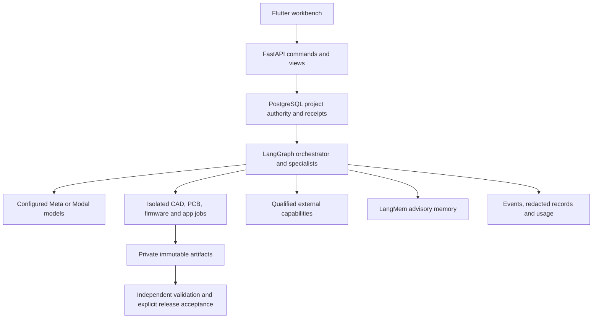

# Kleos9

> Backend rewrite in progress: the active backend is now under
> [`backend/src/kleos`](backend/src/kleos), with LangGraph/LangMem and a fresh schema.
> Use the [current backend README](backend/README.md)
> and [verification/progress record](backend/docs/rewrite-progress.md) for current
> setup and limitations. The replacement is not yet qualified for full UI cutover.

Kleos9 is an agentic hardware and software workbench. A user describes a device,
refines an interactive concept, reviews feasibility, and confirms shared
engineering interfaces before workers generate CAD, electronics, firmware and a
companion application. Independent checks and revision-linked evidence control
what can become an accepted release.

The repository contains the existing Flutter experience, a real engineering
backend, a separate simulation backend, isolated native builders, and AWS
infrastructure. **Hosted fabrication, human acceptance, purchases, printing,
packing and shipping remain explicitly simulated.** Digital outputs and supported
checks are real; an attractive concept preview is not manufacturing approval.
The [Bambu integration](backend/src/kleos/capabilities/fabrication/README.md)
provides local connection semantics and isolated digital plate preparation.
Printer dispatch remains blocked by server policy. The
[human-work adapter](backend/src/kleos/capabilities/human_work/README.md) supports
local drafts and explicitly installed read-only observations; hiring and payment
are not enabled by those capabilities.

## Documentation map

| Document | Use it for |
|---|---|
| [AGENTS.md](AGENTS.md) | Shared instructions for coding agents and contributors |
| [CLAUDE.md](CLAUDE.md) | Claude Code entry point to the same repository guidance |
| [Product approval plan](agentic-diy-platform-approval-plan.md) | Intended journey, business modules and engineering gates |
| [Backend README](backend/README.md) | APIs, providers, workflows, permissions and operations |
| [Flutter README](kleos-ui/README.md) | Frontend modes, routing, authentication, transport and UI verification |
| [Mock backend README](mock-backend/README.md) | Scripted journey, seeded data and zero-provider-cost development |
| [Native image guide](backend/src/kleos/execution/README.md) | Native toolchains, image builds and qualification |
| [Capability registry](backend/src/kleos/capabilities/README.md) | Installing qualified tools and external-service capabilities |
| [Infrastructure README](infra/README.md) | AWS provisioning, deployment and recovery |
| [Native engineering review](backend/docs/rewrite-progress.md) | Latest scoped local verification and known limits |

Use implementation and verification records to distinguish current behavior from
the broader approval plan. Test reports describe particular versions and fixtures;
they do not certify arbitrary devices, providers or deployments.

## What is implemented

| Area | Current behavior |
|---|---|
| Capture and research | Conversational requirements, saved answers, automatic planning continuation, provisional 3D anatomy/concept scenes and feasibility refinement |
| Coordination | Shared requirements/interfaces, accepted appearance references, dependencies, bounded attempts, repairs, blockers and revision invalidation |
| Models | Direct Meta API; configured Modal Shared Endpoints; versioned per-lane choices in Providers, usage and estimated cost records |
| Mechanics | build123d sources, real STEP/STL, geometry-derived parts/manifests, rendered CAD views and display-only exploded views |
| Electronics | Deterministic `interfaces.circuit` → KiCad schematic/placed board → pinned Freerouting → ERC/DRC → manufacturing exports and independent correspondence checks; optional advisory ideal-circuit simulation (explicit bindings, local Docker only) |
| Firmware | Isolated Zephyr compilation for explicitly qualified boards; device behavior remains unverified |
| Companion apps | Isolated Flutter web build and separate-origin preview; APK and device/BLE behavior remain unqualified |
| Validation/releases | Independent checks, exact artifact closures, source hashes, evidence applicability and downloadable release packages |
| Integrations | Versioned connector contracts, research/catalog adapters, read-only printer bridges, Bambu offline plate preparation and explicitly simulated fulfillment |
| Operations | Durable command/event ledgers, LangGraph recovery, redacted model/tool records, usage and run inspection |
| Memory | Project-scoped LangMem advisory retrieval; PostgreSQL remains authoritative; consent never starts training |

The initial offline PCB catalog qualifies passives, LEDs and pin headers. New
symbols/footprints, active components, boards, layouts and peripheral scenarios
need their own qualification. Unsupported work stays blocked or `UNKNOWN`.
Circuit and device simulation in the replacement remain explicitly `UNKNOWN`
where no qualified checker is installed. Rendering a board or compiling an app
is not proof of electrical behavior, physical fit or device communication.

## Architecture



One modular codebase has separate API, objective, verification, fabrication and
external-observation process entry points. LangGraph owns workflow checkpoints
and resumption. PostgreSQL owns project facts and durable effect receipts;
LangMem retrieval cannot overwrite that authority. Local artifacts are stored
by content hash. S3/ECS deployment adapters and cloud cutover remain incomplete.

### Authority and execution

Every engineering attempt pins its project revision, provider/model policy,
source references/hashes, tool installation, resource profile and fencing token.
Generated outputs are candidates. The independent validator and release services
own acceptance; synthetic physical evidence cannot unlock a live physical gate.

Supported native sessions expose fixed read, patch, build, analyze and render
actions. The model loop remains in the trusted worker; native jobs receive no
provider keys, database credentials, Docker socket or AWS task role. Sessions
persist limits, action identities and observations across recovery. Custom tool
images keep their classic build flow until their session protocol is qualified.

Partial repairs preserve unchanged source hashes/provenance. **Rebuild saved
sources** runs native compute without a new model/retrieval call. Cancellation
immediately prevents publication, while compute termination is reconciled
separately. Recovery does not promise exactly-once billed inference.

Further details: [native execution](backend/src/kleos/execution/README.md),
[project authority](backend/src/kleos/projects/README.md),
[orchestration](backend/src/kleos/orchestration/README.md), and
[independent validation](backend/src/kleos/validation/README.md).

## Prerequisites

- Python **3.12** for the backend and its locked development environment.
- Flutter/Dart for the workbench; CI currently pins Flutter **3.47.8** in
  [ci.yml](.github/workflows/ci.yml). The companion image separately pins Flutter
  **3.35.4**; these are different build environments.
- Docker Engine/Desktop and Compose v2. Native dispatch needs Engine API 1.45+.
- Native images target **linux/amd64**. Apple Silicon uses Docker emulation;
  native CAD execution directly on the development host is unsupported.
- Terraform 1.10+ for infrastructure work; CI pins 1.14.6.
- Provider credentials only for real inference/embeddings. Simulation and ordinary
  fixture/unit tests do not require model credits.

Native builds can use several GiB of memory and scratch space. Configure only
exact qualified images and keep generated code inside their isolated runtimes.
See the [current execution guide](backend/src/kleos/execution/README.md).
Android APK generation is not qualified by the replacement's Flutter web checks.

## Start the replacement backend locally

The replacement requires a **fresh PostgreSQL database**. Preserve the previous
`backend/.env`, project data and volumes. Existing provider values
`KLEOS_META_API_KEY`, `KLEOS_MODAL_LLM_KEY` and `KLEOS_MODAL_LLM_URL` are accepted
unchanged; old database/authentication settings are not inherited from that file.

Install the locked development environment:

```bash
cd backend
uv sync --locked
```

Set `KLEOS2_DATABASE_URL` to the fresh database and configure a persistent
`KLEOS2_SESSION_SECRET` in your private process environment. For authenticated
setup, also configure `KLEOS2_SETUP_TOKEN`. Local-only no-login mode is an explicit
`KLEOS2_DEVELOPMENT_NO_LOGIN=true` choice and is forbidden in production.
Do not commit credentials or reuse a historical application database.

```bash
.venv/bin/python -m kleos.cli migrate
.venv/bin/python -m kleos.cli serve --host 127.0.0.1 --port 8000
```

The API does not start workers or migrate implicitly. Start an objective worker
separately only when model use is intended; it can incur provider charges:

```bash
.venv/bin/python -m kleos.cli worker
```

The fresh `backend/Dockerfile` and `backend/compose.yaml` provide an alternative
local package with separate setup, worker and preview profiles. Its default API
startup does not enable a model worker or give containers a native Docker socket.
Use the [local package guide](backend/docs/local-runtime.md) for container commands,
the [backend instructions](backend/README.md) for configuration and the
[progress record](backend/docs/rewrite-progress.md) for current qualification.
Cloud deployment and full unchanged-workbench cutover remain incomplete.

| Local service | Default address/purpose |
|---|---|
| Flutter workbench | `http://127.0.0.1:5180` after the next step |
| Control API | `http://127.0.0.1:8000/api/v1` |
| Readiness | `/api/v1/ready` on the control API |
| OpenAPI UI | `http://127.0.0.1:8000/docs` |
| Companion preview | Separate opt-in process/origin, normally port 8004 |
| PostgreSQL | Explicit fresh host database or private Compose service |

### Start Flutter against the real backend

In another terminal:

```bash
cd kleos-ui
flutter pub get --enforce-lockfile
flutter run -d web-server --web-hostname 127.0.0.1 --web-port 5180 \
  --dart-define=KLEOS_BACKEND=production \
  --dart-define=API_BASE_URL=http://127.0.0.1:8000/api/v1
```

Open `http://127.0.0.1:5180`. `KLEOS_BACKEND=production` selects the real transport;
it does not turn on physical fulfillment. Creating a real build can start paid
planning automatically. Use the mock mode below for a zero-credit UI journey.

### Configure isolated native workers

Engineering requires explicitly installed, qualified tool images. Missing tools
remain visible blockers. The replacement uses fixed session entry points built
from [execution/Dockerfile](backend/src/kleos/execution/Dockerfile); an immutable,
qualified toolchain parent is required. See the
[execution guide](backend/src/kleos/execution/README.md) and its per-lane
qualification records before building or installing an image.

Set `KLEOS2_NATIVE_TOOLS` only with the exact image, provider version and matching
qualification reference. Local Docker Desktop compatibility must be explicitly
configured and cannot qualify ECS execution. Generator outputs remain candidates;
independent checker installations and a separate acceptance command control
release. Reports using source overrides do not qualify an unmodified image.

### Use the simulation backend

This mode keeps all seeded connectors, providers, human/developer tasks and the
scripted product journey. State is in memory and resets on simulator restart.
It does not spend model credits or place external orders.

```bash
cd mock-backend
python3.12 -m venv .venv
.venv/bin/python -m pip install -r requirements.lock
.venv/bin/python -m uvicorn app.main:app --host 127.0.0.1 --port 8002
```

In another terminal, choose mock transport by omitting the production flag:

```bash
cd kleos-ui
flutter pub get --enforce-lockfile
flutter run -d web-server --web-hostname 127.0.0.1 --web-port 5180 \
  --dart-define=API_BASE_URL=http://127.0.0.1:8002/api
```

Port 8002 avoids a clash with the real API on 8000. Only one frontend can bind 5180.
The real workbench can also receive
`--dart-define=KLEOS_SIMULATION_API_BASE_URL=http://127.0.0.1:8002/api`
for its explicit simulated-demo path. Real engineering never silently falls back
to simulation.

## Models, tools and usage policy

Provider credentials stay server-side. The replacement reads existing
`KLEOS_META_API_KEY`, `KLEOS_MODAL_LLM_KEY` and `KLEOS_MODAL_LLM_URL` unchanged.
Meta Muse Spark is the default text/image model when both providers are configured;
Modal remains selectable. Explicit catalogs and project lane choices override the
defaults. See [provider wiring](backend/docs/provider-wiring.md) for exact models,
precedence and scoped verification.

Attempts retain their pinned provider, tool, resource and spend contracts. Only
the explicitly configured Modal rate-limit fallback is allowed; no general silent
provider switching occurs. Objective budgets and native capacity are bounded by
[current settings](backend/src/kleos/infrastructure/settings.py). The local package
does not enable unlimited usage or automatically start model workers.

Project writers can select qualified installed tools. They cannot supply arbitrary
images, commands, credentials or release authority. The
[capability registry](backend/src/kleos/capabilities/README.md) documents current
bindings and the limits of plugin support. An installed tool or green fixture does
not qualify arbitrary hardware.

## API and frontend contracts

| Interface | Purpose |
|---|---|
| `POST /api/v1/commands` | Durable, idempotent commands with expected-revision checks; returns 202 with identifiers |
| `GET /api/v1/projects` | Authorized project summaries |
| `GET /api/v1/projects/{id}/workspace` | Consistent snapshot, revision and event cursor |
| `GET /api/v1/projects/{id}/events` | Reconnectable server-sent events |
| `GET /api/v1/runs/{id}` | Tasks, attempts, context, evidence, usage and blockers |
| `GET /api/v1/model-catalog` | Configured model choices and capability metadata |
| `GET /api/v1/engineering-tools` | Installed/qualified engineering-tool catalog |
| `GET /api/v1/artifacts/{id}/download` | Authorized artifact transfer information |
| `GET /api/v1/releases/{id}/download` | Accepted release bundle |

JSON remains camelCase. Clients retain command identifiers across uncertain
submissions and deduplicate committed event sequences after reconnecting. Native
callbacks are job-scoped internal interfaces, not customer command APIs.

During the backend rewrite, the checked-in UI contract remains the compatibility
target. Export the implemented runtime separately and verify the existing transport
from the repository root:

```bash
(cd backend && .venv/bin/python -m kleos.cli export-runtime-contracts)
(cd kleos-ui && python3 tool/generate_transport.py --check)
```

An intentional change to the public UI contract must update its source and
regenerate Dart transport with `python3 tool/generate_transport.py` in `kleos-ui`.
Do not hand-edit `kleos-ui/lib/data/models/api.generated.dart` or bypass response
validation to hide contract drift. Runtime route presence does not establish
service availability or frontend parity.

## Tests and verification

The normal suites use fixtures/mocked providers and do not intentionally call
paid inference APIs. With development dependencies installed:

```bash
(cd backend && .venv/bin/ruff check . && .venv/bin/pytest -q)
(cd mock-backend && ../backend/.venv/bin/python -m pytest tests -q)
(cd kleos-ui && python3 tool/generate_transport.py --check && flutter analyze && flutter test)
git diff --check
```

For database checks, run `alembic upgrade head` and `alembic check` from `backend/`
against the intended local database. PostgreSQL/recovery tests additionally opt
in through `KLEOS_TEST_POSTGRES_URL`; their fixtures create disposable test
databases. Never point test opt-ins at a production database/server.

```bash
terraform -chdir=infra fmt -check
terraform -chdir=infra init -backend=false
terraform -chdir=infra validate
terraform -chdir=infra test
```

Terraform tests use mocked providers. They do not apply AWS changes or establish
live networking, recovery or load-test success. Native qualification tools and
HTTP/browser runtime tests require their stated local services and explicit
opt-ins. Live model probes spend credits, have bounded budgets and can be locked
after use; do not clear those guards to repeat routine verification.

The [rewrite progress record](backend/docs/rewrite-progress.md) records scoped
checks and their limitations. Historical counts and artifacts are not evidence
that the current replacement supports the same integrations.

## Observability, storage and operations

Durable events, redacted model/tool records, usage and source hashes connect
project, run, task and native-job identities. Do not record credentials or private
model reasoning. Project deletion is a tombstone: ordinary access stops while
artifacts and recovery history remain retained.

The fresh local Compose package persists PostgreSQL and artifacts in named volumes.
Container recreation is not data deletion. Use the same explicit private env file
and Compose project name for subsequent operations. Stop services without removing
volumes:

```bash
docker compose --env-file /path/to/private-rewrite.env -f backend/compose.yaml stop
```

Deleting volumes, `backend/.data`, accepted artifacts or workflow history requires
separate authorization. Resetting the mock affects only its simulated state.
Native compute uses independently qualified resource bounds; the control image
does not execute generated project code.

## Deployment

The existing AWS Terraform and deployment workflow still describe parts of the
previous backend and are not a deployment path for this replacement. Fresh cloud
storage/execution adapters, configuration, release tooling and qualification are
unfinished. Do not infer cloud readiness from the local container smoke test.
No cloud resources were changed by the rewrite verification.

Keep [infrastructure guidance](infra/README.md),
[native networking constraints](infra/native-network.md) and
[capacity constraints](infra/native-capacity.md) as review inputs for that phase.
A main-branch push can trigger the existing workflow; do not push or deploy without
the requested deployment scope and a reviewed concrete release.

## Troubleshooting

| Symptom | Check |
|---|---|
| UI shows fixtures instead of real builds | Start with `KLEOS_BACKEND=production` and the real `/api/v1` base URL |
| Development sign-in asks for a token | Set local `KLEOS2_DEVELOPMENT_NO_LOGIN=true` explicitly, or complete authenticated setup |
| Phone cannot connect | Confirm current LAN IP, backend bind address, exact CORS origin, frontend host and API/preview URLs |
| Native tool unavailable | Verify the exact image and qualification reference in `KLEOS2_NATIVE_TOOLS` |
| PCB component/layout remains blocked | Check the accepted circuit, vetted symbol/footprint pair and explicit placement/interface constraints; unsupported scope stays visible |
| App build reports resource failure | Inspect native logs/profile; use private disk scratch, qualified offline caches and the pinned Android toolchain |
| Saved sources exist after a failed build | Use Rebuild saved sources when eligible; it avoids a fresh AI call but still requires independent validation |
| Provider missing/throttled | Check server-side configuration and explicit model choice; do not replace it silently |
| Event stream lost progress | Reconnect from its cursor; reload the workspace on expiry/gaps rather than repeating the command |
| Schema check fails | Export OpenAPI, regenerate Dart transport and review the contract diff |

For a change, follow [AGENTS.md](AGENTS.md): preserve user work, keep the UI and
simulation stable, test the affected behavior, and report the actual scope of
verification.
